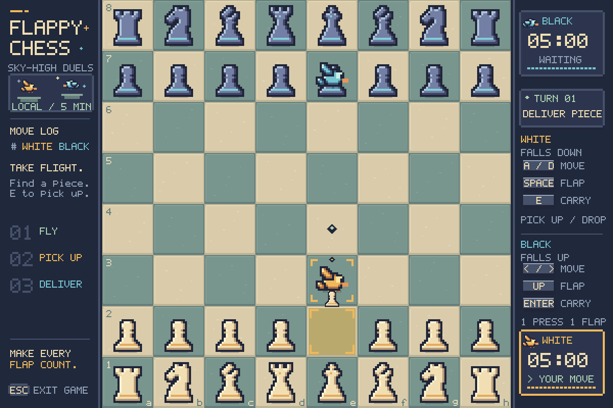

# Flappy Chess

A desktop and browser libGDX chess game controlled by two flying birds.



## Run and develop

Building requires a Java 17 JDK. Running the desktop version also requires a
graphical desktop and OpenGL support. Java 17 and the Linux graphics libraries
were already installed on the development machine.
The checked-in Gradle wrapper downloads Gradle and all Java/native dependencies;
no global Gradle, Maven, JavaFX, or Android SDK installation is needed.

```sh
cd /home/amicablepigeon/Projects/flappy-chess
./gradlew :lwjgl3:run
```

On Windows, use `gradlew.bat` instead of `./gradlew`.

```sh
./gradlew build                 # Compile, test, and package desktop + browser
./gradlew :core:test            # Run game logic/input tests without a display
./gradlew :lwjgl3:installDist   # Create a launcher and dependency directory
./gradlew :lwjgl3:run --args=--smoke-test  # Render 30 frames, then exit
```

The installed launcher is `lwjgl3/build/install/flappy-chess/bin/flappy-chess`.
ZIP/TAR distributions are in `lwjgl3/build/distributions/`. They include assets
and dependencies but require Java 17. Tests are reported at
`core/build/reports/tests/test/index.html`.

In IntelliJ IDEA, open this directory as a Gradle project, select JDK 17 for the
project and Gradle JVM, and use the shared **Flappy Chess** run configuration.
In VS Code, install the workspace's recommended Java/Gradle extensions and use
the supplied run/debug configuration or build/run tasks. Linux desktop is the
validated desktop target; the browser prototype is validated in Chromium.

## Browser prototype

The browser version runs the same local two-player game, with both players on
one keyboard. It is the first step toward online play; remote multiplayer,
room links, and a match server are future work. Players need a keyboard and a
WebGL-capable browser, with no Java installation.

Build and serve locally using the Java 17 JDK:

```sh
./gradlew :web:run
# Open http://localhost:8080; Ctrl+C stops the server.
./gradlew :web:run -PwebPort=8088  # Optional alternate port
./gradlew :web:dist               # Build static files without starting a server
```

The distribution is `web/build/dist/`. Serve the entire directory over HTTP;
opening `index.html` directly with `file://` will not load browser assets.
The start screen shows both players' controls. Arrow keys and Space are captured
by the game, and losing focus releases held input. Clocks continue while the
game is unfocused. Escape returns to the start screen and ends the current game.

Browser smoke checks require Node.js 22+ and an installed Chromium or Chrome:

```sh
./gradlew :web:browserTest
# If your executable is named google-chrome:
CHROME_BIN=google-chrome ./gradlew :web:browserTest
```

These checks use Chromium's DevTools protocol without npm dependencies. They
load the game under `/flappy-chess/`, exercise pickup/drop and keyboard input,
check coasting after focus loss, resize the canvas, check WebGL errors, and
return to the start screen. Screenshots are saved under
`web/build/reports/browser/`. Regular `build` runs all JVM tests and compiles the
browser distribution; browser smoke checks are a separate task.

## Publish on GitHub Pages

The [Pages workflow](.github/workflows/pages.yml) builds and tests pull requests.
Pushes to `main` also publish the browser distribution after the tests pass.

1. In the GitHub repository, open **Settings → Pages**.
2. Under **Build and deployment**, set **Source** to **GitHub Actions**.
3. Push these commits to `main`, or run **Build and publish browser game** from
   the repository's **Actions** tab after the workflow has been pushed.

The deployment job reports the published URL. The game uses relative asset
URLs so it works at a project-site path such as `/flappy-chess/`. The workflow
publishes static files and requires no application server or extra secrets.
GitHub Pages hosts this local-play prototype; future remote multiplayer will
need a separate match server.

## Play

Both birds move continuously, with opposite gravity. Fly the active player's
bird over a piece, pick it up, then carry it to a highlighted legal destination.
The bird's center determines its board square. Dropping back on the original
square cancels the pickup; an illegal destination keeps the piece carried.

| Action | White | Black |
| --- | --- | --- |
| Move left/right | A / D | Left / Right |
| Flap against gravity | Space | Up |
| Pick up / drop | E | Enter |

Promotion: **Q** queen, **R** rook, **B** bishop, **N** knight.
After a game ends, press **R** or click **Play again**. **Esc** exits.
Each side has five minutes; the active player's clock keeps running during
promotion and while the window is unfocused.

## Project layout

- `core/src/main/java/com/example/flappychess/model`: tuned bird physics,
  chess rules, and clock models, with the package renamed.
- `core/.../controller`: adapted input and chess controllers plus `GameSession`.
- `core/.../view`: board presentation state and libGDX drawing.
- `lwjgl3`: desktop launcher and distribution configuration.
- `web`: TeaVM browser launcher, JavaScript build, local server, and browser smoke checks.
- `assets`: retained original images and licensed fonts.
- `core/src/test`: migrated model/controller tests and new session/coordinate tests.

The libGDX loop uses a fixed 60 Hz physics step and a real-time chess clock.
Birds travel horizontally at up to 216 logical pixels/second, easing into motion
and coasting about 70 pixels after releasing a movement key at full speed.
Falling is capped at 252 pixels/second for a gentler glide. A flap climbs
about one square (100 pixels), reaching its peak in about 0.7 seconds. Movement
tuning lives in `Birb`; its constants use pixels per physics step, not per frame.
The board scales with the window while retaining its original 800x800 logical
coordinates. Focus loss releases held controls. GPU resources are disposed on exit.
The pixel-art presentation pairs moss-and-sand stone tiles with midnight-blue
panels, hand-authored chess sprites, and animated birds. Gold identifies the
white bird; blue identifies the black bird. Pixel lettering, stepped frames,
control keycaps, and segmented clock bars carry the style through the HUD and
promotion/game-over screens. Square coordinates, legal destination diamonds,
capture brackets, and a coral check warning keep the board readable. The active
clock changes to a warning color in the final 30 seconds.

`PixelSprites` and `PixelFont` build their small texture atlases from original
code-defined artwork at startup. A 600x400 framebuffer is scaled with nearest
filtering inside the 1200x800 logical fit viewport, keeping the pixel grid
consistent as the window resizes. Visual pixel snapping does not affect bird
physics or the coordinates used for pickup/drop.
The original JavaFX views, FXML placeholder, and JavaFX-specific view tests were
replaced; this port has no JavaFX or FXGL dependency. Audio is disabled because
the example contains no sound assets.

Versions: Java 17, Gradle 9.1.0 (checksum-verified wrapper), libGDX 1.14.2,
gdx-teavm 1.6.2, chesslib 1.3.6, JUnit 5.12.1. Dependencies resolve from Maven Central, with
JitPack restricted to chesslib's group. Version settings are in
`gradle.properties` and the wrapper configuration.

See [AGENTS.md](AGENTS.md) for architecture, gameplay invariants, and contributor
validation guidance.

Reference: [libGDX development setup](https://libgdx.com/wiki/start/setup) and
[project structure/setup](https://libgdx.com/wiki/start/project-generation).

## Attribution

The original `wings.png`, `bird.jpeg`, and `background.png` images are retained
as assets; the pixel-art renderer uses its own code-defined artwork.
Noto Sans Symbols 2 remains bundled under the SIL Open Font License; see
`assets/fonts/OFL.txt`. No new license is assigned to the original game or images.
Liberation Sans remains bundled under the SIL Open Font License;
see `assets/fonts/Liberation-LICENSE.txt` for its copyright and license.
